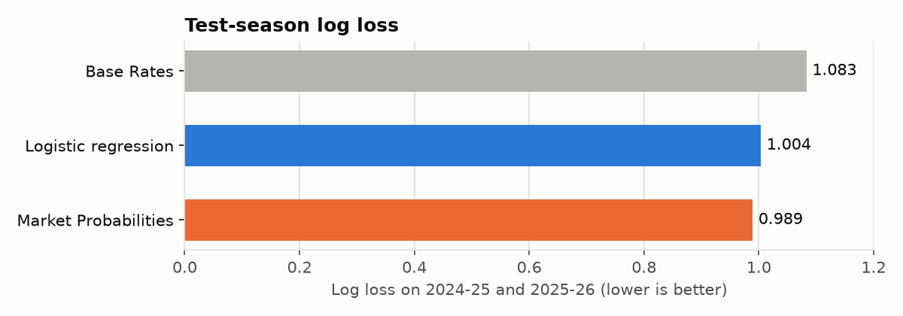
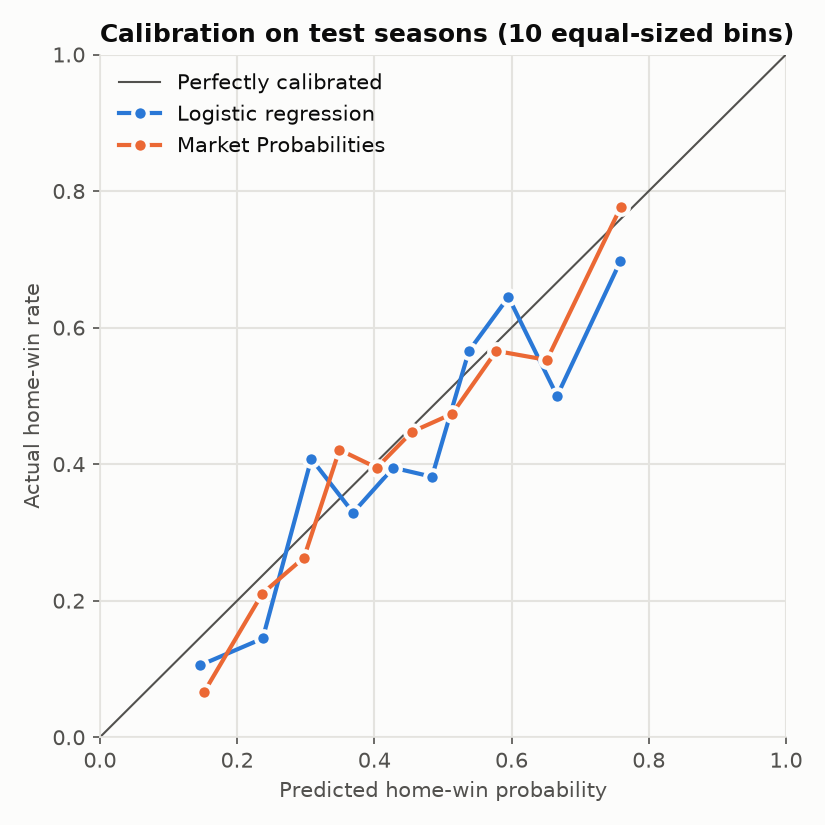

# EPL Match Outcome Predictor

Gives Home win / Draw / Away win probabilities for Premier League matches, using only information available before kickoff. The model is trained on 21 seasons (8,000+ matches) stored in SQLite. It is judged on probability quality against simple baselines and against bookmakers' closing odds.

## Results

Two held-out seasons (2024-25 and 2025-26, 760 matches), scored once after every modelling choice was fixed:

| Forecast | Accuracy | Log loss ↓ | Brier ↓ |
|---|---|---|---|
| Always predict a home win | 41.7% | ∞ | 1.166 |
| Base rates (long-run H/D/A frequencies) | 41.7% | 1.083 | 0.657 |
| **This model (logistic regression)** | **50.7%** | **1.004** | **0.602** |
| Bookmakers (average closing odds, margin removed) | 52.5% | 0.989 | 0.592 |

**On log loss, the model is 7.3% better than the base rates and 0.014 behind the betting market.** The market prices in team news, injuries and lineups that public results data doesn't contain, so a small gap is the realistic outcome. A model that claimed to beat it by a wide margin would most likely be leaking information.





The calibration plot puts matches into ten bins by predicted home-win probability. It compares each bin's average prediction with how often the home team actually won. Points on the diagonal mean that "60%" really happens about 60% of the time. Each bin holds about 76 matches, so some zigzag is noise.

Why log loss is the headline: accuracy only checks the most likely outcome, so a model that says 40% home win and one that says 90% get the same credit when the home team wins. Log loss and Brier score measure whether the probabilities themselves are honest, which is what matters if you act on them.

## How it works

```
football-data.co.uk CSVs ─► SQLite (matches) ─► Pre-match Features (match_features) ─► model ─► evaluation
```

1. **Data:** `fetch_data.py` downloads one CSV per season (2005-06 to the current season). `build_db.py` loads them into a `matches` table in SQLite (`schema.sql`), along with results, shots, corners, cards and closing odds.
2. **Features:** `build_dataset.py` goes through the matches in date order. For each date, it records every team's state *before* applying that day's results:
   - **Elo rating** (`ratings.py`) for both teams, and the difference between them. Promoted teams take over the relegated teams' average rating, and every rating is pulled 20% back toward the average each summer.
   - **Form:** points per game over the last 5 matches.
   - **Rolling averages** over the last 10 matches: goals and shots on target, both for and against.
3. **Model selection:** `train_model.py` fits each candidate on 2006-07 to 2021-22 and compares them on 2022-23 and 2023-24. 2005-06 is used only to warm up the ratings, because every team starts it at the same Elo.

   | Candidate (validation seasons) | Log loss | Brier |
   |---|---|---|
   | Base rates | 1.052 | 0.635 |
   | **Logistic regression** | **0.947** | **0.561** |
   | Logistic regression + calibration | 0.951 | 0.563 |
   | Random forest | 0.958 | 0.567 |
   | Random forest + calibration | 0.961 | 0.569 |

   The winner is refit on all training and validation seasons. `tune_elo.py` chose Elo's update size the same way, using validation seasons only.
4. **Evaluation:** `evaluate.py` scores the refit model on the test seasons against each baseline and draws the charts.

## Decisions worth explaining

- **Avoiding leakage.** A feature for a match may only use matches that finished before its kickoff. A test (`tests/test_features.py`) changes one match's result and checks that no feature on or before that date changes. I checked that the test fails when results are deliberately applied too early.
- **A time-based split instead of a random one.** A random split would let the model train on 2024 matches and be tested on 2019 ones. That flatters the score, because it uses information that wasn't available at the time.
- **Logistic regression over a random forest.** With 13 fairly smooth features, the simpler model was better on validation log loss. Its coefficients are also easy to read: Elo difference and shots on target carry most of the signal.
- **No calibration step.** Calibration fixes models whose probabilities are systematically too confident or too timid. Logistic regression's probabilities were already well calibrated, so adding a calibration layer (fitted with time-ordered folds) made validation log loss slightly worse.
- **The original design leaked.** The project started from hand-written tactical match notes with 0–100 ratings. Those ratings are written *after* watching the match, so using them to predict that same match leaks the result. They're now an analyst layer, not training data ([ADR 0001](docs/adr/0001-tactical-notes-explain-not-predict.md)).

## Analyst layer (in progress)

`teams/` holds tactical profiles for the 2025-26 teams, and `match_analysis/` holds match notes. The planned next step is **Analyst Adjustments**: tactical claims like "Doku's pace against Frimpong is worth +25 Elo to City", stored in a YAML file and applied on top of the model. Each prediction is logged before kickoff, so it's possible to measure whether the adjustments improve on the model ([ADR 0002](docs/adr/0002-analyst-adjustments-in-elo-points.md)). `CONTEXT.md` defines the project's terms.

## Running it

Python 3.11+ on Windows (on macOS/Linux, use `.venv/bin/python`):

```
python -m venv .venv
.venv/Scripts/python -m pip install -r requirements.txt
.venv/Scripts/python src/fetch_data.py      # only needed for new results; data/raw/ is committed
.venv/Scripts/python src/build_db.py
.venv/Scripts/python src/build_dataset.py
.venv/Scripts/python src/train_model.py
.venv/Scripts/python src/evaluate.py
.venv/Scripts/python -m pytest -q
```

## Notes

Data comes from [football-data.co.uk](https://www.football-data.co.uk/). Parts of the code were written with AI coding assistants. The design decisions and their reasons are documented above and in `docs/adr/`.
